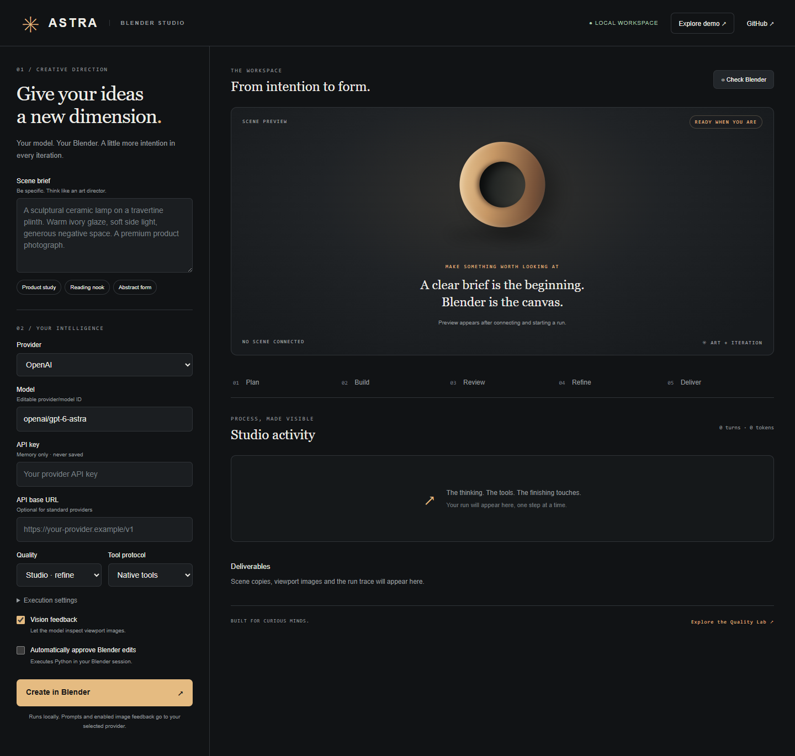

# Astra Blender Harness

[English](README.md)

**Blender protegido para agentes y modelos de IA. Construye en Blender - en pantalla o sin interfaz - y comprueba qué pasó de verdad.**

Astra se coloca entre una IA y Blender. Usa el agente que ya tienes (Claude Code, Codex, Cursor, Claude Desktop, cualquier cliente MCP) o trae una API key y deja que el bucle propio de Astra trabaje. En ambos casos la IA obtiene lo que le falta al acceso directo a Blender:

- **Astra Guard** rechaza el Python peligroso que escribe el modelo antes de que llegue a Blender: nada de `os`/`subprocess`, `eval`/`open`, escapes del intérprete, handlers, instalación de add-ons ni sobrescribir tu `.blend`.
- **Una auditoría después de cada edición**, como diferencia: qué problemas introdujo y cuáles resolvió - sujetos recortados o fuera de cuadro, materiales que faltan, piezas bajo el suelo o separadas del cuerpo.
- **Herramientas revisadas** para lo que los modelos fallan más: encuadre de cámara, ensamblar piezas, apoyar objetos en el suelo, keyframes y comprobación de movimiento.
- **Checkpoints** guardados como copias verificadas, y restauración. Tu archivo original nunca se sobrescribe.
- **Un visor 3D en vivo** en el navegador, sincronizado con Blender, para ver la escena mientras la IA trabaja, con reproducción de animación.
- **Puertas de calidad** de [Blender Quality Lab](https://github.com/AleBrito124356/blender-quality-lab) si está instalado: visibilidad real con ray casting, alcance de las luces, grupos flotantes y una lista «Fix first» con Python listo para ejecutar.

Blender puede ser **tu Blender abierto** (el add-on [Blender MCP](https://github.com/ahujasid/blender-mcp), 1.x o 2.x) o **un Blender sin interfaz que Astra arranca** - el paquete `bpy` de PyPI o un ejecutable de Blender -, así que también funciona en CI, contenedores y agentes en la nube sin pantalla.



> Versión 0.4.0. El backend headless, el servidor MCP y el bucle del motor están probados contra Blender 5.2.3 LTS y 4.5.15 LTS reales (headless, desde `bpy`). El backend socket está probado contra una réplica del protocolo del add-on; versiones anteriores se probaron con Blender 4.5.9/5.2.1 con interfaz a través de Blender MCP 1.9.1. La calidad de los modelos no está medida. Ver [validación](docs/validation.md).

## Tres formas de usarlo

| Tienes | Usa | Quién maneja Blender |
| --- | --- | --- |
| Un agente: Claude Code, Codex, Cursor, Claude Desktop, VS Code, Gemini CLI | `astra-blender mcp`, un servidor MCP | Tu agente y su modelo; Astra protege y audita cada paso |
| Una API key (OpenAI, Anthropic, Gemini, DeepSeek, OpenRouter, NVIDIA NIM, Ollama...) | `astra-blender serve`, el estudio local | El bucle planificar → construir → revisar → refinar de Astra, con tus aprobaciones |
| Una terminal o un job de CI | `astra-blender run "brief"` | El mismo bucle, sin interfaz si quieres |

## Inicio rápido

Necesitas Python 3.11+.

```sh
pip install "astra-blender-harness @ git+https://github.com/AleBrito124356/astra-blender-harness"
```

Elige de dónde sale Blender:

- **Tu Blender abierto.** Instala el add-on Blender MCP en Blender y pulsa su botón de inicio en la barra lateral del viewport 3D (puerto 9876). Nada más: Astra habla directamente con el add-on, sin `uvx` ni un segundo servidor MCP.
- **Sin interfaz (headless).** `pip install bpy` en un Python compatible con el paquete (bpy 5.2 → Python 3.13, bpy 4.5 → Python 3.11) y apunta Astra a él: `export ASTRA_BLENDER=/ruta/a/ese/python`. También sirve un ejecutable de Blender (`blender` en el PATH o `ASTRA_BLENDER=/ruta/a/blender`). Si instalas Astra en ese mismo Python (`pip install "astra-blender-harness[headless] @ git+..."`) no hace falta ninguna variable.

Compruébalo:

```sh
astra-blender doctor                     # tu Blender abierto (socket)
astra-blender doctor --backend headless  # un Blender sin interfaz
```

### Con Claude Code

```text
/plugin marketplace add AleBrito124356/astra-blender-harness
/plugin install astra-blender@astra-blender
```

El plugin añade el servidor MCP y una skill que enseña el ciclo construir → auditar → corregir. Sin plugins:

```sh
claude mcp add astra-blender -- uvx --from git+https://github.com/AleBrito124356/astra-blender-harness astra-blender mcp
```

Después pide lo que quieras: *«Modela una lámpara de escritorio de mediados de siglo sobre un escritorio de nogal, iluminación de producto, encuadrada para un post 4:5.»* El agente llama a `blender_status`, construye con `run_python`, lee cada auditoría, encuadra con `frame_camera` y termina con `quality_check`. Abre la URL del visor que devuelve `blender_status` para mirar.

### Otros agentes

Todos los clientes MCP usan el mismo comando. Ejemplos para Codex, Cursor, Claude Desktop, VS Code y Gemini CLI, y las variables para el modo headless, en [docs/agents.md](docs/agents.md).

`astra-blender mcp` usa por defecto `--backend auto`: tu Blender abierto si su add-on escucha, si no un Blender headless si hay uno instalado; se decide en cada conexión. Fuerza uno con `--backend socket` o `--backend headless` (o `ASTRA_BACKEND`).

### Estudio con tu propia API key

```sh
pip install "astra-blender-harness[keyring] @ git+https://github.com/AleBrito124356/astra-blender-harness"
astra-blender serve                       # o: astra-blender serve --backend headless
```

Abre **http://127.0.0.1:8765**, elige modelo, introduce tu clave, comprueba la conexión, escribe un brief y crea. Revisa cada operación de Python propuesta o autoriza la ejecución automática para esa ejecución. **Demo** muestra todo el flujo sin clave ni Blender; sus imágenes son ilustraciones.

La clave se queda en memoria por defecto; si guardas una configuración va al llavero del sistema operativo, nunca a un archivo. Las API keys nunca llegan al proceso de Blender.

## Herramientas MCP

| Herramienta | Qué hace | Cambia la escena |
| --- | --- | --- |
| `blender_status` | Versión de Blender, backend, escena, cámara, guard, checkpoints, URL del visor | no |
| `inspect_scene` | Límites y dimensiones en el mundo, encuadre de cada objeto, materiales, render, capacidades reales de la API y problemas detectados; `objects=[...]` para enfocar | no |
| `run_python` | Ejecuta un script si Astra Guard lo acepta; devuelve su salida y la auditoría posterior (nuevos / resueltos / pendientes). La primera edición de la sesión guarda el checkpoint `start` | sí |
| `look` | Una imagen: el viewport de un Blender de escritorio, o una vista previa por la cámara de la escena en uno headless | no |
| `frame_camera` | Ajusta la cámara activa a los sujetos indicados, también a lo largo de una animación | solo cámara |
| `assemble_parts` | Emparenta piezas a un Empty sin moverlas; registra anclas y separaciones permitidas | sí |
| `place_on_ground` | Apoya un conjunto entero en un suelo sin desalinear sus piezas | sí |
| `keyframe_object` | Keys de posición/rotación/escala en espacio local, en radianes | sí |
| `inspect_animation` | Poses evaluadas y un barrido de 16 frames: solapamientos nuevos, piezas bajo el suelo o separadas | no |
| `checkpoint` / `restore_checkpoint` | Copias verificadas en la carpeta de la sesión, y restaurarlas por etiqueta | restaurar: sí |
| `quality_check` | Las puertas de Blender Quality Lab sobre la escena en vivo y una lista «Fix first» con Python (si está instalado) | no |

El prompt `build_scene` empaqueta el flujo para los clientes que muestran prompts MCP. Todo lo de una sesión de agente queda en `runs/agent-<fecha>/` (`edits.jsonl` registra cada script con su intención).

## De dónde sale Blender

| Backend | Para qué | Notas |
| --- | --- | --- |
| `socket` (por defecto en `serve`/`run`) | Tu Blender abierto con el add-on Blender MCP | Directo al socket del add-on (127.0.0.1:9876). Funciona con el add-on 1.x y 2.x. Las capturas necesitan Blender en la misma máquina. |
| `headless` | CI, contenedores, agentes en la nube, lotes, o sin interfaz | Astra arranca un Blender en segundo plano (paquete bpy o ejecutable), solo en 127.0.0.1 y con un token por proceso, sin tus API keys en su entorno. `look` renderiza una vista previa con Workbench (Cycles en CPU si no hay GPU/EGL). `--file escena.blend` abre un archivo en vez de la escena de fábrica. El proceso termina con Astra. |
| `auto` (por defecto en `mcp`) | Agentes | Socket si el add-on escucha; si no, headless. |
| `stdio` / `http` | Un servidor MCP como el Blender MCP oficial, o uno remoto | Para configuraciones que lo necesiten. En el 2.x oficial, `look` sustituye al `get_viewport_screenshot` eliminado. El safe mode del servidor oficial se suma a Astra Guard. |

Se elige con `--backend`, `--blender RUTA`, `--file X.blend` o un JSON con `--config` ([mcp.example.json](mcp.example.json), [examples/](examples)). No cargues configuraciones de fuentes no confiables: pueden lanzar programas.

## Astra Guard

El código del modelo llega a Blender por `run_python` (MCP) o `execute_blender_code` (estudio y CLI). La salida de herramientas, nombres de assets e imágenes de referencia entran en el contexto del modelo, y un modelo con inyección de prompt puede acabar escribiendo código hostil que alguien aprueba sin leer cada línea. Astra Guard analiza cada script y lo rechaza indicando la línea y el motivo cuando contiene:

- imports fuera de una lista permitida (`bpy`, `bpy_extras`, `bmesh`, `mathutils`, `math`, `random`, `json`, `collections`, `itertools`, `re`, `array` y otros módulos de Python puro). `numpy` no está - sus funciones de archivos, pickle y librerías nativas no se pueden acotar estáticamente -, ni `typing` y `string`, que evalúan o formatean cadenas como código; `foreach_get`/`foreach_set` funcionan con `array.array`;
- `eval`, `exec`, `compile`, `__import__`, `open`, `input`, `globals`/`locals`/`vars`, atributos dunder, frames y tracebacks, nombres calculados en `getattr`/`setattr`, campos de `str.format` que acceden a atributos;
- código que sobrevive a la llamada o carga código: `bpy.app.handlers`/`timers`, el namespace de drivers, `register_class`, bloques de texto, librerías `.blend` enlazadas o anexadas, operadores de scripts/texto/preferencias/extensiones, activar la ejecución automática de scripts incrustados, expresiones de driver con imports;
- operadores de archivo de escena (`open_mainfile`, `save_mainfile`, `save_as_mainfile`, revertir, ajustes de fábrica): Astra guarda copias verificadas por su cuenta.

Los espacios de nombres con operadores peligrosos (`bpy`, `bpy.ops`, `bpy.ops.<grupo>`, `bpy.app`, `bpy.utils`) solo se pueden usar directamente o con un alias simple (`ops = bpy.ops`): metidos en una lista, devueltos por una lambda, pasados a una función o leídos con un nombre calculado ocultarían qué operador se ejecuta. Los alias cuentan todas las rutas que un nombre recibe en cualquier parte del script, así que las ramas no sirven para disfrazar una, y los nombres de operador más peligrosos (`save_mainfile`, `python_file_run`, `addon_enable`...) se rechazan sobre cualquier receptor.

El código de escena normal - primitivas, bmesh, modificadores, materiales con nodos, drivers, keyframes, importar modelos, renderizar a una ruta - pasa. Los scripts revisados de Astra no pasan por el guard: no contienen texto del modelo. Se desactiva con `--no-guard` o `"guard": false` si hace falta.

**Es una protección, no un sandbox.** El Python de Blender no está confinado y el código aceptado se ejecuta con los permisos de tu usuario. Las aprobaciones y una sesión de Blender desechable siguen siendo la frontera real.

## Estudio y CLI

El estudio y `astra-blender run` manejan Blender con el bucle propio de Astra y cualquier modelo de [LiteLLM](https://docs.litellm.ai/docs/providers):

- **Planificar → construir → revisar → refinar → finalizar.** Planificar y revisar son de solo lectura. Evidencia numérica para cualquier modelo; imágenes del viewport para los que tienen visión. Con Blender Quality Lab instalado, la revisión también recibe `astra_quality_check` - las puertas del lab y su lista «Fix first» - y el refinado la aplica. Draft omite el refinado; Final pide un render moderado.
- **Llamadas nativas a herramientas o acciones JSON estrictas** para modelos de texto sin herramientas, con reparación acotada de respuestas mal formadas.
- **Selector de modelos** desde el catálogo de LiteLLM instalado, que marca soporte de herramientas y visión, y descubrimiento en vivo para pasarelas compatibles con OpenAI como NVIDIA NIM. Los identificadores que no se pueden enrutar se rechazan antes de empezar, indicando la forma correcta.
- **Caché de prompts** para modelos Claude: el prompt de sistema y el mensaje más reciente se marcan como puntos de caché, así cada turno lee de caché la conversación anterior (se cobra una fracción). OpenAI y Gemini cachean solos. `manifest.json` registra los tokens cacheados. `--no-prompt-cache` lo desactiva para pasarelas que rechazan el campo.
- **Presupuestos** de turnos, tokens, tiempo, turnos por fase y tiempo por turno del modelo (300 s por defecto, para modelos de razonamiento); `0` quita el límite. Un turno que expira no se reintenta: nada se cobra dos veces. El plazo se pausa mientras una aprobación te espera.
- **Fotos de referencia** (hasta tres, sin EXIF, 1536 px) para modelos con visión, y **movimiento por ejecución** (detectar, animar o escena fija) con frames y fps.
- **Resultados honestos**: `completed`, `incomplete` (falta un entregable pedido, como la animación; se puede continuar), `budget_exhausted`, `cancelled`, `failed`. Una ejecución detenida se continúa con presupuesto nuevo; recargar la página o reiniciar Astra no pierde nada.
- **Espacio 3D en vivo**: girar, acercar, enfocar objetos, alambre, vista de la cámara de render y reproducción de la animación en el navegador, independiente del modelo. Sincronización incremental: Blender solo serializa las mallas que cambiaron. Ver [detalles del visor](docs/live-scene.md).

```sh
# Pon ASTRA_API_KEY en tu entorno (las claves no van en argumentos de la shell).
astra-blender run "Una tetera de cerámica en un estudio fotográfico cálido" --model anthropic/claude-sonnet-5-5 --auto-approve
astra-blender run "Un rincón de lectura isométrico" --backend headless --model ollama_chat/qwen3 --api-base http://localhost:11434 --no-vision --tool-mode json --auto-approve
```

Sin `--auto-approve` la CLI pregunta antes de cada cambio. Un comando cancelado o que agota el tiempo puede terminar igualmente dentro de Blender; inspecciona antes de repetir. Astra nunca reintenta cambios en Blender automáticamente.

Cada ejecución vive en `runs/<id>/`: copias `.blend` por fase (`checkpoint`, `build`, `refine`, `scene`) que nunca sobrescriben tu archivo, capturas, `quality.json`, `animation.json`, referencias normalizadas, `state.json` para continuar (sin imágenes ni claves), la traza `events.jsonl` con la clave redactada, `manifest.json` y `error.log` si falló.

Los modelos recomendados para empezar (no es un ranking de Blender) están en el [README en inglés](README.md#recommended-starting-models). Con un agente, usa el modelo de tu agente.

## Confianza y privacidad

- El estudio escucha en `127.0.0.1`, valida Host/Origin y usa un token por proceso. Es una app local de un solo usuario.
- El worker headless escucha solo en `127.0.0.1` y rechaza peticiones sin su token. Recibe un entorno filtrado - sin API keys - y termina con Astra.
- Las llamadas a la API envían prompts, salidas de herramientas e imágenes (si están activadas) a tu proveedor; aplican sus políticas.
- El Python se ejecuta con los permisos de Blender. Astra Guard, las aprobaciones y el safe mode oficial reducen el riesgo; ninguno es un sandbox del sistema. Usa una sesión de Blender desechable para prompts o assets no confiables.

## Desarrollo

```sh
python -m pip install -e '.[dev]'
python -m pytest                                          # sin Blender, los tests que lo necesitan se omiten
ASTRA_BLENDER=/ruta/a/python-con-bpy python -m pytest     # añade Blender headless real: motor, servidor MCP, movimiento
python -m ruff check src tests && python -m ruff format --check src tests
```

Los tests no gastan créditos de API. La CI ejecuta la batería en Linux, Windows y macOS, los tests con Blender real contra bpy 5.2 y 4.5 y las pruebas del estudio en el navegador.

Licencia MIT. Proyecto independiente de Alejandro Brito; sin relación con la Blender Foundation, Anthropic, OpenAI, Google ni los autores de Blender MCP.
