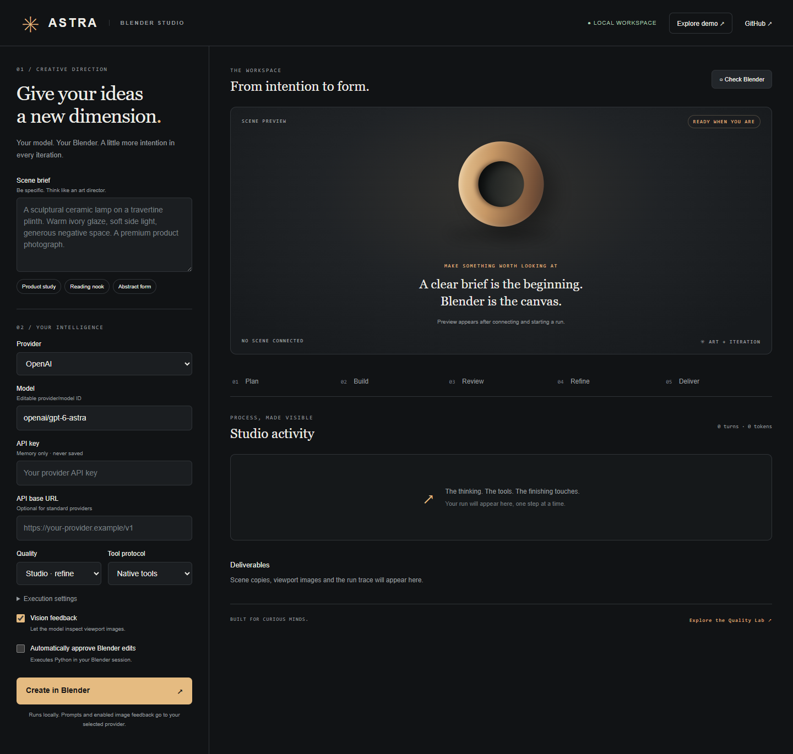

# Astra Blender Harness

[Español](README.es.md)

**Guarded Blender for AI agents and models. Build in Blender - on screen or headless - and see what actually happened.**

Astra sits between an AI and Blender. Bring the agent you already use (Claude Code, Codex, Cursor, Claude Desktop, any MCP client) or bring an API key and let Astra's own loop drive. Either way the AI gets what raw Blender access lacks:

- **Astra Guard** refuses dangerous model-written Python before it reaches Blender: no `os`/`subprocess`, no `eval`/`open`, no interpreter escapes, no handlers or add-on installs, no overwriting your `.blend`.
- **An audit after every edit**, as a delta: which problems the edit introduced and which it fixed - subjects cropped or off frame, missing materials, parts below the ground or detached from their body.
- **Reviewed tools** for what models get wrong most: camera framing, assembling parts, resting things on the ground, keyframes, motion checks.
- **Checkpoints** saved as verified copies, and restore. Your original file is never overwritten.
- **A live 3D viewer** in the browser, synced with Blender, so you watch the scene while the AI works - with motion playback.
- **Quality gates** from [Blender Quality Lab](https://github.com/AleBrito124356/blender-quality-lab) when installed: ray-cast visibility, light reach, floating groups and a "Fix first" list with ready-to-run Python.

Blender comes from **your open Blender** (the [Blender MCP](https://github.com/ahujasid/blender-mcp) add-on, 1.x or 2.x) or from a **headless Blender Astra starts itself** - the `bpy` wheel from PyPI or a Blender executable - so it also runs in CI, containers and cloud agents with no display.



> Version 0.4.0. The headless backend, the MCP server and the engine loop are tested against real Blender 5.2.3 LTS and 4.5.15 LTS (headless, from the bpy wheel). The socket backend is tested against a protocol replica of the add-on; earlier releases were tested with real Blender 4.5.9/5.2.1 GUI sessions through Blender MCP 1.9.1. Model quality is not benchmarked. See [validation](docs/validation.md).

## Three ways in

| You have | Use | What drives Blender |
| --- | --- | --- |
| An agent: Claude Code, Codex, Cursor, Claude Desktop, VS Code, Gemini CLI | `astra-blender mcp` - an MCP server | Your agent and its model; Astra guards and audits every step |
| An API key (OpenAI, Anthropic, Gemini, DeepSeek, OpenRouter, NVIDIA NIM, Ollama...) | `astra-blender serve` - the local studio | Astra's plan → build → review → refine loop, with your approvals |
| A terminal or CI job | `astra-blender run "brief"` | The same loop, headless if you like |

## Quick start

Requires Python 3.11+.

```sh
pip install "astra-blender-harness @ git+https://github.com/AleBrito124356/astra-blender-harness"
```

Then pick where Blender comes from:

- **Your open Blender.** Install the Blender MCP add-on in Blender and press its start button in the 3D viewport sidebar (port 9876). Nothing else: Astra talks to the add-on directly - no `uvx`, no second MCP server.
- **Headless.** `pip install bpy` in a Python that matches the wheel (bpy 5.2 → Python 3.13, bpy 4.5 → Python 3.11), then point Astra at it: `export ASTRA_BLENDER=/path/to/that/python`. A Blender executable works too (`blender` on PATH, or `ASTRA_BLENDER=/path/to/blender`). Installing Astra itself into that Python (`pip install "astra-blender-harness[headless] @ git+..."`) needs no variable at all.

Check it:

```sh
astra-blender doctor                     # your open Blender (socket)
astra-blender doctor --backend headless  # a headless Blender
```

### With Claude Code

```text
/plugin marketplace add AleBrito124356/astra-blender-harness
/plugin install astra-blender@astra-blender
```

The plugin adds the MCP server and a skill that teaches the build → audit → fix loop. Without plugins:

```sh
claude mcp add astra-blender -- uvx --from git+https://github.com/AleBrito124356/astra-blender-harness astra-blender mcp
```

Then ask for what you want: *"Model a mid-century desk lamp on a walnut desk, product-shot lighting, framed for a 4:5 post."* The agent calls `blender_status`, builds with `run_python`, reads each audit, frames with `frame_camera` and finishes with `quality_check`. Open the viewer URL from `blender_status` to watch.

### Other agents

Every MCP client takes the same command. Examples for Codex, Cursor, Claude Desktop, VS Code and Gemini CLI, plus environment variables for headless use, are in [docs/agents.md](docs/agents.md).

`astra-blender mcp` defaults to `--backend auto`: your open Blender when its add-on is listening, otherwise a headless Blender when one is installed - decided at each connection. Force one with `--backend socket` or `--backend headless` (or `ASTRA_BACKEND`).

### Studio with your own API key

```sh
pip install "astra-blender-harness[keyring] @ git+https://github.com/AleBrito124356/astra-blender-harness"
astra-blender serve                       # or: astra-blender serve --backend headless
```

Open **http://127.0.0.1:8765**, choose a model, enter your key, check the connection, write a brief and create. Review each proposed Python operation, or explicitly enable automatic execution for the run. **Demo** shows the whole workflow without a key or Blender; its images are illustrations.

Your API key stays in memory by default; saving a setup puts it in your operating system's keyring, never in a file. API keys never reach the Blender process.

## MCP tools

| Tool | What it does | Changes the scene |
| --- | --- | --- |
| `blender_status` | Blender version, backend, scene, camera, guard, checkpoints, viewer URL | no |
| `inspect_scene` | Evaluated world bounds, dimensions, per-object camera framing, materials, render settings, actual API capabilities and detected problems; `objects=[...]` to focus | no |
| `run_python` | Runs a script after Astra Guard accepts it; returns its output plus the after-edit audit (new / resolved / still open). The first edit of a session checkpoints `start` automatically | yes |
| `look` | An image: the 3D viewport of a desktop Blender, or a quick preview through the scene camera in a headless one | no |
| `frame_camera` | Fit the active camera around named subjects, optionally across animation frames | camera only |
| `assemble_parts` | Parent parts to an Empty root without moving them; records anchors and allowed gaps | yes |
| `place_on_ground` | Rest a whole assembly on a ground mesh, keeping part alignment | yes |
| `keyframe_object` | Location/rotation/scale keys in local space, radians | yes |
| `inspect_animation` | Evaluated poses plus a 16-frame sweep: new overlaps, ground breaches, detached parts | no |
| `checkpoint` / `restore_checkpoint` | Verified scene copies in the session folder, and restoring them by label | restore: yes |
| `quality_check` | Blender Quality Lab's gates on the live scene and a "Fix first" list with Python (when the lab is installed) | no |

A `build_scene` prompt packages the workflow for clients that show MCP prompts. Every script, image and report of an agent session is kept in `runs/agent-<timestamp>/` (`edits.jsonl` logs each script with its stated intent).

## Where Blender comes from

| Backend | Use it for | Notes |
| --- | --- | --- |
| `socket` (default for `serve`/`run`) | Your open Blender with the Blender MCP add-on | Direct to the add-on's socket (127.0.0.1:9876). Works with add-on 1.x and 2.x. Screenshots need Blender on the same machine. |
| `headless` | CI, containers, cloud agents, batch work, or no GUI wanted | Astra starts a background Blender from the bpy wheel or a Blender executable, bound to 127.0.0.1 with a per-process token, without your API keys in its environment. `look` renders a preview with Workbench (Cycles CPU when no GPU/EGL is available). `--file scene.blend` opens a file instead of the factory scene. The process ends with Astra. |
| `auto` (default for `mcp`) | Agents | Socket when the add-on is listening, otherwise headless. |
| `stdio` / `http` | An MCP server such as upstream Blender MCP, or a remote one | Kept for setups that need them. Upstream 2.x's `look` stands in for the removed `get_viewport_screenshot`. Upstream safe mode applies in addition to Astra Guard. |

Choose with `--backend`, `--blender PATH`, `--file X.blend`, or a JSON file passed with `--config` ([mcp.example.json](mcp.example.json), [examples/](examples)). Never load configuration files from untrusted sources: they can launch programs.

## Astra Guard

Model-written code reaches Blender through `run_python` (MCP) or `execute_blender_code` (studio and CLI). Tool output, asset names and reference images flow into the model's context, and a prompt-injected model can be talked into writing hostile code that a person approves without reading every line. Astra Guard parses each script and refuses, naming the line and the reason:

- imports outside an allowlist (`bpy`, `bpy_extras`, `bmesh`, `mathutils`, `math`, `random`, `json`, `numpy`, `collections`, `itertools`, `re` and other plain-Python modules);
- `eval`, `exec`, `compile`, `__import__`, `open`, `input`, `globals`/`locals`/`vars`, dunder attributes, frame and traceback internals, computed `getattr`/`setattr` names, `str.format` fields that reach into attributes;
- code that outlives the call or loads code: `bpy.app.handlers`/`timers`, the driver namespace, `register_class`, text datablocks, linked or appended `.blend` libraries, script/text/preferences/extensions operators, enabling auto-run of embedded scripts, scripted driver expressions with imports;
- scene-file operators (`open_mainfile`, `save_mainfile`, `save_as_mainfile`, revert, factory reset): Astra saves verified copies itself.

Ordinary scene code - primitives, bmesh, modifiers, node materials, drivers, keyframes, imports of models, renders to a path - passes. Astra's own reviewed scripts never go through the guard; they contain no model text. Disable it with `--no-guard` or `"guard": false` if you must.

**It is a guard, not a sandbox.** Blender's Python is not confined, and accepted code runs with your user's permissions. Approvals and a disposable Blender session remain the real boundary.

## Studio and CLI

The studio and `astra-blender run` drive Blender with Astra's own loop, using any [LiteLLM](https://docs.litellm.ai/docs/providers) model:

- **Plan → build → review → refine → finalize.** Planning and review are read-only. Numerical scene evidence for every model; viewport images for vision models. Draft skips refinement; Final asks for a modest render.
- **Native tool calls, or strict JSON actions** for text models without tool use, with bounded repair of malformed responses.
- **Model picker** from the installed LiteLLM catalog showing tool-calling and vision support, plus live model discovery for OpenAI-compatible gateways such as NVIDIA NIM. Unroutable identifiers are refused before the run starts, naming the prefixed form to use.
- **Prompt caching** for Claude models: the system prompt and newest message are marked as cache breakpoints, so each turn reads the conversation before it from cache (billed at a fraction). OpenAI and Gemini cache automatically. Cached tokens are reported in `manifest.json`. `--no-prompt-cache` turns it off for gateways that reject the field.
- **Budgets** for turns, tokens, wall clock, per-phase turns and per-turn model timeout (default 300 s for reasoning models); `0` removes a limit. Timed-out turns are never retried, so nothing is billed twice. The deadline pauses while an approval waits for you.
- **Reference photos** (up to three, EXIF removed, 1536 px) for vision models, and **motion per run** (detect, animate or still) with frames and fps.
- **Honest outcomes**: `completed`, `incomplete` (a requested deliverable such as animation is missing; continuable), `budget_exhausted`, `cancelled`, `failed`. Runs that stop early can be continued with a fresh budget; reloading the page or restarting Astra loses nothing.
- **Live 3D workspace**: orbit, zoom, focus objects, wireframe, render-camera view and baked motion playback in the browser, independent of the model. Incremental sync: Blender serializes only meshes that changed. See [live scene details](docs/live-scene.md).

```sh
# Set ASTRA_API_KEY in your environment (keys do not belong in shell arguments).
astra-blender run "Create a ceramic teapot in a warm photographic studio" --model anthropic/claude-sonnet-5-5 --auto-approve
astra-blender run "An isometric reading nook" --backend headless --model ollama_chat/qwen3 --api-base http://localhost:11434 --no-vision --tool-mode json --auto-approve
astra-blender run "Animate the car doors opening over 48 frames" --model openai/gpt-6-astra --animation on --frames 48 --reference car.jpg --auto-approve
```

Without `--auto-approve` the CLI asks before every mutation. A cancelled or timed-out command can still finish inside Blender; inspect before retrying. Blender mutations are never retried automatically.

### Run files

Each run lives in `runs/<id>/`: `checkpoint.blend` (before any edit), `build.blend`, `refine.blend` and `scene.blend` (final) as copies that never overwrite your file; `viewport-NNN.png` and `final.png` when rendered; `quality.json` and `animation.json`; `reference-N.jpg`; `state.json` (to continue; no images or keys); `events.jsonl` (the trace, key redacted); `manifest.json`; `error.log` on failure.

### Recommended starting models

Engineering starting points from documented capabilities (tool calling and vision in the LiteLLM catalog installed on **2026-11-02**), **not a Blender benchmark**. With an agent, use whatever model your agent runs.

| Use | Model identifier | Why start here |
| --- | --- | --- |
| Complex scenes | `anthropic/claude-fable-5-1`, `openai/gpt-6-astra` | Top-tier reasoning and code, tools and vision |
| Balanced | `anthropic/claude-opus-5-5`, `openai/gpt-6.1-sol` | Strong results at lower cost |
| Fast iteration | `anthropic/claude-sonnet-5-5`, `openai/gpt-6.1-terra`, `gemini/gemini-3.8-flash` | Speed for repeated edits |
| Low-cost experiments | `anthropic/claude-haiku-5-5`, `openai/gpt-6-luna` | Cheap draft passes |
| Text-only reasoning | `deepseek/deepseek-v4-pro` | No vision: turn Vision off; Astra's numerical evidence is built for it |
| Local/private | `ollama_chat/<model>` | No hosted provider; pick a model with tool calls |
| Custom gateway | `openai/<gateway-model-id>` | OpenAI-compatible base URL including `/v1`; **↻** asks the gateway what it serves |

If a model rejects tool declarations, select **JSON actions**; if it rejects images, disable **Vision feedback**. Embedding, audio-only and image-generation models cannot run this harness. A chat subscription is not API access.

## Quality workflow

Be specific about subject, style, real-world scale, camera and deliverable. Start with **Draft**, check silhouette and composition, then **Studio** for review and refinement. **Final** asks for a finished render within the same bounded phases; render completion is not guaranteed.

Install [Blender Quality Lab](https://github.com/AleBrito124356/blender-quality-lab) next to Astra (`pip install git+https://github.com/AleBrito124356/blender-quality-lab`) for `quality_check`, reusable briefs, a scoring rubric and run summaries. Checks are evidence, not taste: passing them does not prove a beautiful image.

## Local trust and privacy

- The studio binds to `127.0.0.1`, validates Host/Origin and uses a per-process API token. It is a single-user local app, not an internet-facing service.
- The headless worker listens on `127.0.0.1` only and refuses requests without its per-process token. It receives an allowlisted environment - no API keys - and exits when Astra does.
- API calls send prompts, tool output and (when enabled) images to your chosen provider; its policies apply. With an agent, your agent's provider sees the same.
- Python runs with Blender's permissions. Astra Guard, approvals and upstream safe mode reduce risk; none is an OS sandbox. Use a disposable Blender session for untrusted prompts or assets.
- Token limits are not a dollar cap; set a spending limit with your provider. Traces and scene files contain your work: do not commit private runs.

## Development

```sh
python -m pip install -e '.[dev]'
python -m pytest                                      # offline; Blender tests skip without a Blender
ASTRA_BLENDER=/path/to/python-with-bpy python -m pytest   # adds real headless Blender: engine, MCP server, motion
python -m ruff check src tests && python -m ruff format --check src tests
python -m build
# Only when editing the browser viewer (the built bundle is committed):
npm ci && npm run build
```

Tests spend no API credits. CI ([.github/workflows/ci.yml](.github/workflows/ci.yml)) runs the suite on Linux, Windows and macOS, the real-Blender tests against bpy 5.2 and 4.5, and the studio's browser checks. See [validation](docs/validation.md) for what was exercised and [CHANGELOG.md](CHANGELOG.md) for changes.

MIT licensed. Independent project by Alejandro Brito; not affiliated with the Blender Foundation, Anthropic, OpenAI, Google or the Blender MCP authors.
